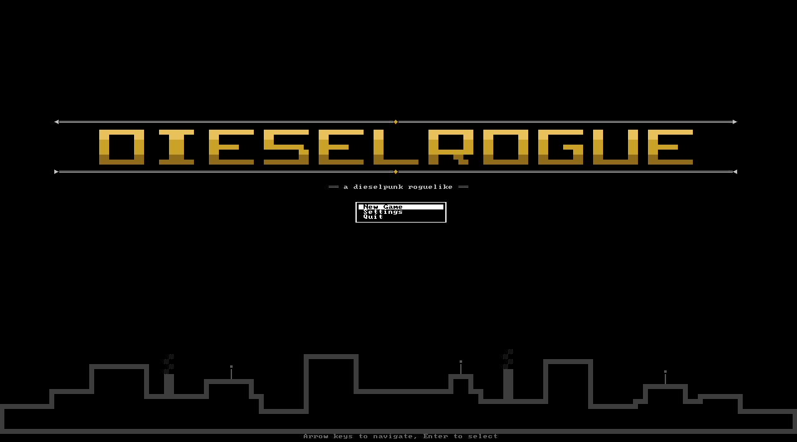
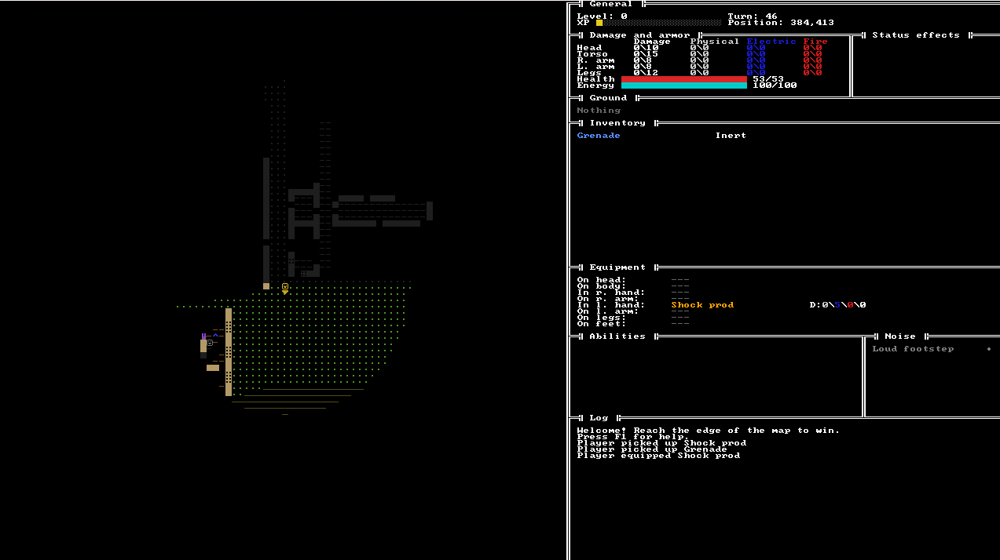
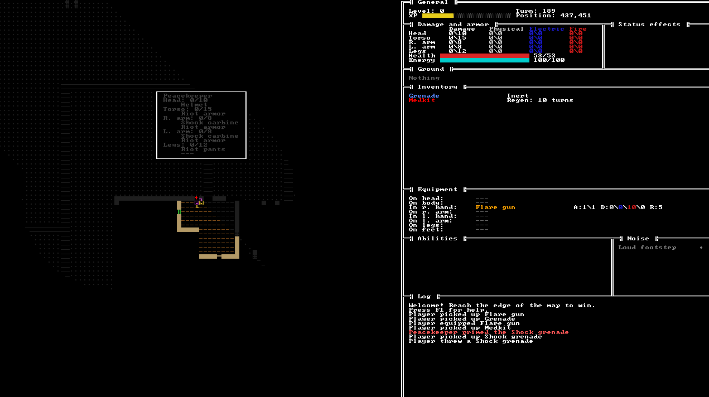

# DieselRogue

A roguelike set in a 1930's world, where technology is fuelled by oil and high voltage electricity.
The game has a single, large level which the player must escape to win, utilizing what equipment
and vehicles they find along the way. Ranged combat and stealth are the main options, but if a
tank can be found, it may be easier to simply run over your enemies. Assuming they don't have
anti tank weaponry...

There is no randomness in the game except for map generation and enemy actions. Turns occur
simultaneously and actions are entirely deterministic.

The interface consists of traditional, ASCII-like tiles using a modified CP437 font. The game is
implemented in Rust, using a software renderer inspired by RLTK.

## Screenshots

*The main menu screen.*

*The main gameplay screen, with the map viewport and the status, inventory, equipment, and log panels.*

*Inspecting an enemy which, incidentally, is about to kill the player.*

## Building

DieselRogue is a standard Rust project, so install Rust and execute *cargo run* from the project root.
